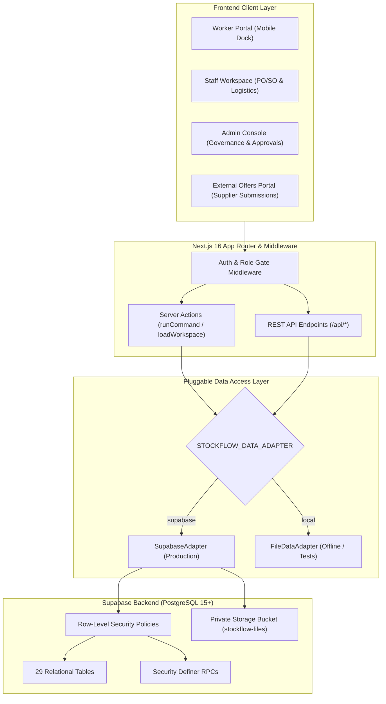
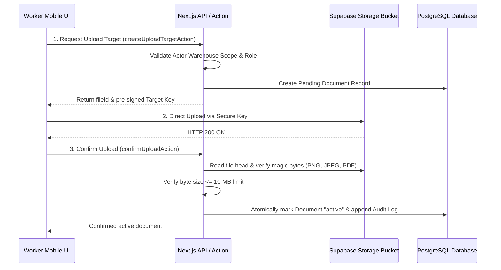

# StockFlow — System Architecture & Technical Specification

## 1. Architectural Overview

StockFlow is designed as a hybrid enterprise warehouse application. It combines high-throughput physical operations on warehouse docks with strict multi-tier administrative governance, real-time inventory ledger accounting, and external partner self-service portals.

---

## 2. Frontend Architecture & State Synchronization

### 2.1 Workspace Context & State Machine
The client state is coordinated via `WorkspaceProvider` (`src/components/providers/workspace-provider.tsx`), exposing a single unified state object:
- **`DemoState`**: Compiled, reactive view of directory records (warehouses, companies, materials, packaging types), purchase orders, shipments, worker requests, inventory stock balances, ledger entries, and audit logs.
- **Actor Identity**: Contains user identity, normalized active role, assigned warehouse, company affiliation, and session validity.
- **Optimistic Execution & Error Recovery**: Commands are executed via `runCommand(name, payload)` Server Action. Successful actions broadcast updates via `BroadcastChannel("stockflow_workspace")`, triggering immediate tab-to-tab sync.

### 2.2 Worker Mobile Dock Navigation
The worker module utilizes a dedicated floating dock navigation bar with hardware-accelerated animations:
- **Floating pill design**: 4 primary tabs: Dashboard (`/dashboard`), Inbound (`/containers`), Outbound (`/outbound`), and Inventory (`/inventory`).
- **Sliding indicator**: 220ms bezier transition indicator matching active tabs.
- **Zero sticky collision**: 96px padded operational viewport preventing buttons or keyboards from obscuring controls.

---

## 3. Storage & Evidence Processing Pipeline

Physical warehouse operations mandate empirical verification (e.g., container seal integrity, damaged cargo packaging, clean trailer interior).

---

## 4. Demurrage Calculation Engine

Demurrage represents demurrage and detention costs accrued when a container or trailer stays on dock past allotted free time:
1. **Free Time Allowance**: Default free time threshold (e.g., 120 minutes for unloading, 90 minutes for loading).
2. **Elapsed Computation**: Measured continuously from `unloading_started_at` or `loading_started_at` to handover or completion.
3. **Status Categorization**:
   - **Green (Normal)**: Elapsed time within free allowance.
   - **Amber (Warning)**: Within 15 minutes of fee assessment.
   - **Red (Billable Demurrage)**: Elapsed time exceeds threshold; displays accrued delay in minutes and billable rate alert.
4. **Live UI Refresh**: Uses `useLiveNow` to drive minute-by-minute UI re-evaluation without network polling.

---

## 5. Inventory Transaction Ledger & Idempotency

Stock balances are calculated via an immutable append-only ledger (`inventory_history` / `stock_movements`). Direct manual balance modifications are prohibited.

### 5.1 Balance Invariant
$$\text{Current Balance} = \sum \text{Approved Inbound Net Weight} - \sum \text{Completed Outbound Net Weight}$$

### 5.2 Idempotency Protocol
- Each movement requires an operation identifier (`request_id` or `shipment_id`).
- When a worker submits completion, `rpc_worker_complete_request` checks for existing ledger entries with that operation ID.
- Duplicate submissions return the existing confirmed movement without creating double-posted stock.
