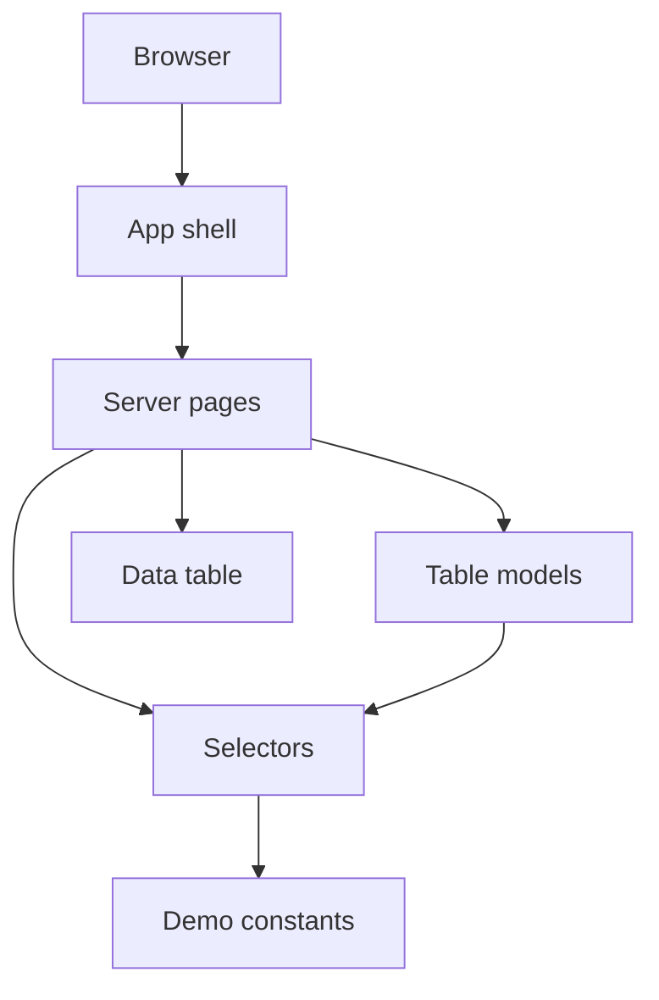

# StockFlow architecture

Phase 1 is a Next.js App Router interface. Pages read typed sample records, derive totals in plain functions, and render them. There is no database and no request to a StockFlow API.

## Stack

- Next.js 16.4 with the App Router and `src/`
- React 19
- TypeScript
- Tailwind CSS v4, loaded with `@import "tailwindcss"` in `src/app/globals.css`
- ESLint via `eslint-config-next`
- Cache Components and Partial Prefetching, already set in `next.config.ts`

Tailwind v4 does not use a `tailwind.config` file in this project. Theme tokens for background, foreground, and the Geist fonts are declared with `@theme inline` in `globals.css`. The palette stays white and near-black. The app sets `color-scheme: light` so the operating system dark theme does not invert the workspace.

## Request flow

Server pages stay free of client state. Two client islands handle interaction:

- `AppShell` opens and closes the mobile sidebar and marks the current route
- `DataTable` filters the rows it was given. The filter state lives in the browser and is discarded on reload

Shared layout for the workspace routes is `src/app/(workspace)/layout.tsx`. The `(workspace)` segment does not appear in the URL. `/` redirects to `/dashboard` from `next.config.ts`, so the root does not render a page that calls `redirect()` during prerender.

## Module map

| Path | Responsibility |
| --- | --- |
| `src/lib/types.ts` | Entity and status types |
| `src/lib/demo-data.ts` | Compiled sample records and the sample date |
| `src/lib/selectors.ts` | Joins and dashboard totals |
| `src/lib/presentation.ts` | Status labels and monochrome tones |
| `src/lib/table-models.ts` | Serializable table columns and cells |
| `src/lib/navigation.ts` | Sidebar groups and route matching |
| `src/lib/format.ts` | Kilograms, tonnes, percents, and calendar dates |
| `src/components/shell/` | Sidebar, top bar, and responsive shell |
| `src/components/ui/` | Headings, callouts, panels, stats, tables, meters, empty states |
| `src/app/(workspace)/*/page.tsx` | One server page per route |

Table cells are plain objects. Server pages pass them into the client table, so render functions are not sent across the server/client boundary.

## Dates and prerendering

Sample dates are `YYYY-MM-DD` strings. `formatIsoDate` formats them without constructing a `Date`, so pages do not read the current time during prerender. Cache Components is left enabled. Pages do not read cookies, headers, or search params.

## What is intentionally absent

- `src/app/api`
- Database clients and environment secrets
- Authentication middleware
- Mutation actions

A later phase can replace `src/lib/demo-data.ts` with server reads. Pages should keep depending on the selector shapes in `src/lib/selectors.ts` so that swap stays local.
